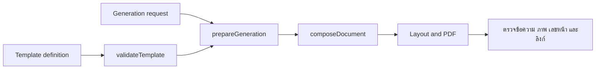

# FlowDoc Document Authoring — Developer Documentation

## Authority Boundary

เจ้าของเอกสาร: FlowDoc Project Control; บทบาท Documentation Synthesizer.
ขอบเขต: เอกสารอ้างอิงสำหรับผู้เขียน Template และผู้เรียก authoring API ของ
Area18 candidate รุ่น 0.4.0 ไม่ใช่การรับรองความพร้อมของ FlowDoc ทุกระบบ.
Core เป็นเจ้าของ schema/validation/layout; Service เป็นเจ้าของ storage/transport.
งานนี้เป็น single-room ตามคำขอผู้ใช้; execution/Phase/Checklist IDs ไม่เกี่ยวข้อง.
ไม่เปลี่ยน runtime, template ของผู้ใช้, ข้อมูลต้นทาง หรือ publish.

Baseline: `nodeModelVersion:18`, `schemaVersion:1/2`, Service ที่ใช้
`@flowdoc/core@0.4.0` และ Service candidate `0.4.0`; ต้องผ่าน preflight ของ package/runtime จริง.
อ่าน [แหล่งอ้างอิงและผลตรวจ](verification.md) ก่อนนำไปใช้กับรุ่นอื่น.

## อ่านจากตรงไหน

เริ่มจาก [ทางเข้าแบบอ่านตามช่วง](workflow-start.md) แล้วเปิดเฉพาะหัวข้อของช่วงที่ทำ.
หน้านี้เป็นสารบัญอ้างอิงตอนเลือกสัญญาที่ต้องใช้ ไม่ใช่รายการให้อ่านทุกบทก่อนเริ่ม.

คู่มือเลือกใช้แบ่งเป็นสามชั้น:

1. **หลักร่วม** — [การถอดแบบ](reference-mapping.md) และ reference ด้านล่าง:
   ข้อมูล หน่วย การจัดแนว ภาพ และเกณฑ์ตรวจ ใช้ร่วมทุกหมวด.
2. **ลักษณะเอกสาร** — [แบบฟอร์ม/ข้อจำกัด](reference-mapping.md#2-เลือกหมวดตามลักษณะการจัดหน้า) หรือ [เนื้อหาไหล](document-families/flowing-book.md).
   เลือกตามพฤติกรรมการจัดหน้า ไม่เลือกจากชื่อ SRS/สัญญา/รายงานอย่างเดียว.
3. **กรณีที่พบ** — อยู่ภายในหมวด: สิ่งที่เห็น → วิธีเลือก → เหตุผล/เกณฑ์ตรวจ;
   เปิดสัญญารายละเอียดจากลิงก์เฉพาะเรื่อง ไม่คัด reference ซ้ำ.

แบบฟอร์มอยู่ใน mapping เดิม ไม่เพิ่มไฟล์บังคับอ่าน. เพิ่มกรณีเมื่อกฎต่างจริง;
ถ้าต่างเพียงชื่อให้ใช้กรณีเดิม. แนวทางไม่ใช่หลักฐานว่ารองรับทุกความสามารถ.

| ต้องการทำอะไร | เอกสาร |
| --- | --- |
| อ่านต้นแบบแล้วเลือกโครง รักษาเส้น กรอบ ภาพ และข้อมูล | [แนวทางถอดแบบ](reference-mapping.md) |
| ตรวจทุกส่วนจาก PDF ก่อนเลือกโครงเก่า และเก็บหลักฐานเทียบก่อนส่งงาน | [Source-first coverage](reference-coverage.md) |
| เลือก draft ใหม่/ซ่อม ID เดิม/ทดแทนเมื่ออนุญาต และใช้ tool ทำ preview ต่อเนื่อง | [Draft selection และ workflow tool](draft-selection.md) |
| เข้าใจโครงทั้งเล่มและประกาศ Section/Area/Format | [โครงสร้างและตัวแปร](structure-and-data.md) |
| เลือก node และ property ที่เขียนได้ | [Node reference](nodes.md) |
| คำนวณพื้นที่ ตาราง ภาพ หัวท้าย และเลขหน้า | [Layout reference](layout.md) |
| ทำสารบัญ ลิงก์ และข้อมูลซ้ำเป็นกลุ่ม | [สารบัญและข้อมูลซ้ำ](contents-and-repetition.md) |
| สร้าง ID แก้ draft upload validate preview และรับ PDF | [API และเครื่องมือ](api.md) |
| เริ่มจากไฟล์ที่รันทดสอบได้ | [ตัวอย่างและเกณฑ์ตรวจ](examples.md) |
| ตรวจที่มาของข้อกำหนดและข้อจำกัด | [หลักฐานและ coverage](verification.md) |

คู่มือขั้นตอนถอดแบบ PDF อยู่ที่
[AI template authoring guide](../../domains/flowdoc-ai-template-authoring-guide.md).
เอกสารชุดนี้อธิบายสัญญาที่คู่มือขั้นตอนใช้อ้างอิง ไม่ต้องโหลดทุกบทเมื่อแก้เพียงเรื่องเดียว.

## กติกาการอ่าน reference

- **Required** หมายถึงต้องระบุ ไม่มีค่าเริ่มต้นให้เดา.
- **Optional** หมายถึงละได้; ตารางจะบอกผลเมื่อละ. Optional ไม่ได้แปลว่ารับ `null`.
- ตัวอย่าง JSON เฉพาะส่วนเป็น fragment ที่ต้องใส่ในตำแหน่งที่ระบุ;
  ไฟล์ตัวอย่างเต็มใน examples เป็น definition/request ที่ตรวจได้.
- ใช้ JSON object/array จริง ไม่ส่ง JSON ทั้งก้อนเป็น string ในช่อง `definition`.
- ฟิลด์นอกสัญญามักถูกปฏิเสธ; field ข้อมูลที่ไม่ประกาศอาจเป็น warning และถูกละเลย.
- TypeScript union มีชนิดของรุ่นเก่ารวมอยู่ด้วย ต้องยึดข้อจำกัด Area18 และ validator
  ตามตำแหน่ง ไม่คัด property จาก resolved document กลับมาเป็น template.
- Validate โครง ≠ compose ข้อมูล ≠ จัดหน้า PDF ≠ ตรงต้นแบบ.
  ต้องผ่านแต่ละชั้นที่เกี่ยวข้อง; ไม่มี warning ไม่ใช่หลักฐานว่าไม่ตกเนื้อหา.

## เส้นทางข้อมูล

Template ประกาศกฎและตำแหน่ง; Request ส่งค่าและเลือก Format ที่ประกาศไว้.
PreparedInput/ResolvedDocument เป็นผลภายใน ไม่ใช่ payload ที่ผู้ใช้ต้องเขียนเอง.
การแก้ข้อมูลไม่ควรต้องเพิ่ม node ต่อรายการ; ใช้ array/repeats/rowGroups ตามความหมาย.

## การรักษาเอกสารนี้

เมื่อเพิ่ม property หรือ node ต้องแก้บทอ้างอิง ตัวอย่าง และ coverage พร้อมกัน.
ระบุชนิด ค่าเริ่มต้น ขอบเขตตำแหน่ง และ failure ที่คาดได้ ไม่เขียนเพียงชื่อ feature.
หากยังไม่ตรวจ runtime ให้ระบุชัดว่าเป็น source inspection ไม่ใช่ render PASS.
ตัวอย่างที่ทำงานได้แต่ไม่ใช้ความสามารถที่ตั้งใจ เช่นสารบัญเป็นตารางข้อความ
ไม่ถือว่าผ่าน acceptance ของ feature นั้น.
