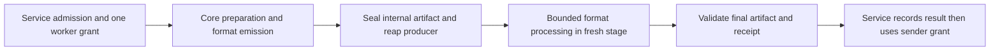

# FlowDoc document execution stages and resource allocation — proposed design

Authority Boundary: Project Control canonical PROPOSED cross-repository design,
owned by Planning Partner / Cross-Repo Boundary Reviewer. Core owns document
semantics; Service owns scheduling, runtime/storage/DB/transport integration.
Status: PROPOSED PRODUCT DESIGN; PRODUCT PROTOCOL NOT IMPLEMENTED OR VERIFIED.
Lab-only handoff/RAM evidence is recorded in the dated addendum below; it does
not verify the Core/Service design. No system-map promotion. Inline IDs N/A.
This design does not grant product edits,
Oracle runs, real-data access, real-service stop, push, release or installation.

## Intent and decisions

Use one execution protocol for all currently supported document templates and
shapes, with format adapters for PDF and DOCX. UAT/SRS are acceptance fixtures,
never routing keys or exceptions in production logic. Unsupported capabilities
remain unsupported; this is not a promise that every input fits in finite RAM.
Excel/OCR/new output formats are outside this round.

Owner explicitly confirmed **512 MiB per worker/execution bundle, as in the
existing Oracle lab**, NOT 512 MiB for the entire Service. Service keeps its
existing 1/4/6 GiB resource profiles and limits. Every worker's Node/launcher/native
descendants/scratch/cache must fit its bundle; multiple stages do not each get
an independent 512 MiB allocation concurrently. Keep the current default 259 MiB
V8 heap in the lab, 1 CPU per measured bundle,64 MiB temp, unchanged output/source
caps. No tuning/install/deploy is performed by this design.

Recommended first implementation: sequential isolated heavy stages under ONE
Service worker grant; bounded XML processing inside the DOCX adapter. This
combines process-lifetime separation with a bounded working set. Stage names
alone, new functions alone, or fewer concurrent jobs do not solve single-job OOM.

Current design round: large cross-owner design, routine read-only risk; current
host inline, no separate WORK dispatch. Proof budget: read actual owner code and
existing C1 evidence only, no runtime proof. Document budget: this canonical
design, narrow D2/queue links and a local source/hash inventory. D2 remains the
authority for the earlier DOCX experiments, not the general Service protocol.

## Verified starting points

References use the inspected development bases Core 3e74f98 / Service a572025;
C1 candidate is still a separate uncommitted two-file change. These facts do
not claim the proposed protocol already exists.

| Actual implementation | Consequence for this design |
| --- | --- |
| Service src/tasks/queue-resources.ts:11-14,26-68,94-120 has intake/worker/sender grants, FIFO per kind, adaptive worker count, actual cgroup sampling, idempotent release and onStop | Extend this coordinator; do not add a Core queue or one queue per phase |
| src/tasks/queue-limits.ts:4 uses base 128 MiB and credits intake 64 / worker 320 / sender 8; queue-profile.ts:7-10 defines 1/4/6 GiB profiles | Worker320 is admission arithmetic, not a measured512 MiB process limit; staged envelopes require an explicit accounting change |
| queue-resources.ts rejects mismatched profile memory samples and stale/unavailable readings | Keep global Service sampling distinct from per-worker sampling; never feed512 MiB worker memory.max into a 4 GiB Service profile |
| src/tasks/processing.ts:273-315 reserves worker, validates task lease, renders, releases worker only after render cleanup, records output, then obtains sender | Retain this ownership/order and one logical job; no worker-held wait for a second phase/sender slot |
| processing.ts:338-342 and jobs/processor.ts:18-31 provide acquireLegacy through the shared worker coordinator when enabled | Legacy integration has a real adapter point; do not bypass it or assert all legacy output/storage contracts already support stages |
| src/tasks/render.ts:46-61,174-180,264-293 owns child/workspace/read grants and waits for process-group disappearance before cleanup/release | Phase transitions must preserve fencing/reaping and distinguish checkpoint sealing from final workspaceSealed |
| runtime/python/task_launcher.py uses RLIMIT_FSIZE only | It is a file bound, NOT an existing hard per-worker memory limit |
| Core src/docx/profile.ts:18-19,435-450 links live intent to preflight capsule through WeakMaps and clones document/mapped data | A JSON intent is not a genuine capability and does not carry private glyph/source proofs across processes |
| Core DOCX writer/source-layout/measurement modules use intent, guides and resources for emission and later receipts | A process boundary needs a new validated handoff and complete receipt facts; simply killing the producer loses required state |
| C1 Linux: 247/247, exact 3 fixture parity,6 consumer cases and UAT pass; SRS still exits 134 after normalization before DOM-return checkpoint | C1 alone is insufficient. No universal memory-saving or full Word-fidelity claim follows |

Terminology disposition: split execution stage from business task/job status;
split ephemeral worker grant, persistent queue-slot reservation, storage hold
and delivery evidence. New stage/artifact labels below are proposed internal
terms, not existing public API fields or newly accepted product truth.

## Ownership and stage graph

| Stage | Owner / input | Output and lifetime boundary |
| --- | --- | --- |
| Accept/normalize/admit | Existing Service authentication, template/font pins, input/disk reservation and intake grant | Immutable accepted input/identities; no heavy job without worker admission |
| Prepare and emit | Core in a bounded worker process; validated input/resource readers | DOCX native/source-emitted ZIP plus compact finalization facts, or a PDF artifact/adapter checkpoint. No publication. Finish all needed glyph/source work before handoff |
| Seal and reap | Service verifies close/size/hash/binding of private artifacts and producer group exit | Only bounded descriptors survive in parent. No live native constructor graph, intent, font Buffers or child heap enters the next stage |
| Format processing | Fresh Core stage, same worker bundle. DOCX uses bounded global planning/replay; PDF can use identity when no postprocessing is needed | Sealed candidate or typed failure; unchanged packages retain original bytes |
| Final validation | Core validates format/content/resource/limit invariants; Service validates artifact receipt against frozen output selection | Verified artifact reference and final receipt. Still no user-visible success until existing persistence boundary completes |
| Record and deliver | Service transaction/fence, then existing sender grant and streaming transport | Preserve generation versus delivery evidence. Never resend automatically because a DB acknowledgement failed |

Core does not receive PostgreSQL connections, HTTP responses, queue ownership
or real storage paths. Service does not reimplement style inheritance, XML
transformations, glyph checks or PDF layout. A standalone Core host can supply
the same bounded IO/execution adapter without Service or a DB.

Prefer sequential fresh heavy processes over an in-process callback-only
pipeline: live closures/WeakMaps would otherwise keep earlier state reachable.
Do not run phases as a parallel DAG initially: overlap adds heaps and disk
copies and complicates ordering/cancellation. No public-layout rewriting is
authorized merely by selecting this orchestration.

## Resource contract with the existing coordinator

1. One task attempt holds one kind=worker grant across its heavy phases and
   reaping gaps. It counts as ONE worker for adaptive processing. No nested
   acquire, phase queue, second slot or release/reacquire on each transition.
   Queue order, maxOutstanding, maxProcessing, thresholds, owner limits and
   input/output caps do not increase. Effective concurrency may decrease.
2. Current320 MiB credit cannot be presented as a 512 MiB memory guarantee.
   Proposed staged policy reserves at least max(existing worker credit,
   sealed bundle envelope), initially 512 MiB for the staged worker. Include
   supervisor/cache overhead inside the envelope or account for it explicitly
   in the parent budget; never hide it. This requires a versioned extension to
   existing queue-resources accounting, not a second allocator or a silent
   edit to frozen policies of old jobs. Existing profile ceilings stay fixed.
3. Admission retains the existing principle
   max(actual instance memory, base + active reservations) + new reservation
   <= profile admission limit, plus existing slot/pressure/freshness checks.
   An already active job does not add its own reservation again at every phase.
   Worker reports cannot select a smaller cost to gain admission. Keep intake,
   sender and legacy worker costs accounted through the same coordinator.
4. The512 MiB hard bundle limit and measured Service-wide limits are separate.
   All descendants and charged file/cache/kernel memory count; summing RSS,
   JS heap deltas or deleting JS bindings does not prove memory returned.
   Page cache can remain after process exit; do not drop host caches.
5. Oracle lab can enforce the bundle with its existing512 MiB container. A
   production launch adapter must prove an equivalent inherited aggregate
   limit and reliable descendant termination before staged mode is enabled.
   Existing process-group polling/RLIMIT_FSIZE does NOT prove a hard RAM limit.
   Do not substitute RLIMIT_AS512 MiB for RSS/cgroup enforcement or obtain new
   runtime privileges implicitly. Launch-adapter provisioning is an open gate.
   Observe the child's actual Node/V8 limits at launch; the Service container's
   limit alone does not establish a child's 259 MiB heap or512 MiB hard bundle.
6. Wait for previous stage close, child/native descendants and owned readers
   to stop before starting the next heavy stage. No overlapping producer and
   consumer heaps. Keep the worker grant if stop is unconfirmed; quarantine
   the attempt and retain accounting rather than admitting another worker.
7. Reuse existing read-cache/index/record grant mechanisms where applicable;
   each child's delegated grant must close before reuse. Keep IPC descriptors
   small; stream data with backpressure. No full ZIP/base64/DOM payload over IPC.

For example, base 128 + staged worker512 fits the1 GiB profile's768 MiB admission
ceiling only while other active reservations also fit. Two such workers cannot
both be admitted there. This is arithmetic for the PROPOSAL, not measured
throughput or a new profile setting. A512 MiB phase lab is not proof that the
entire Service can run under512 MiB.

## Handoff and trust contract

Proposed internal descriptor fields:

| Field | Required meaning |
| --- | --- |
| contractVersion / producer | Exact handoff schema, Core package hash/version and adapter version |
| executionBinding | Opaque Service-issued binding to current task/job, attempt, output format, input/template/resource pins and policy version; no raw DB lease token |
| predecessor / sequence | Expected previous artifact digest and monotonic stage sequence; one accepted completion per sequence |
| artifacts | Opaque IO keys, media/kind, size and SHA256; parent derives confined paths, never trusts a child-supplied absolute path |
| finalizationFacts | Bounded Core-produced plain receipt/resource/source-ownership facts sufficient after producer exit; no intent/constructor/closure/Buffer graph |
| measurements / bounds | Observed counts/bytes and policy-bound scratch/metadata limits, not authority to change limits or claim success |

The producer must finish DOCX source-layout emission and freeze all later
receipt facts, including applied guides, field/numbering/measurement adaptations,
before exiting. The consumer must not need to reconstruct an ExportIntent from
JSON or bypass requireGenuineIntent. Stage 2 is a separately designed Core API
for generated-package processing, not writeDocx(fakeIntent). Completeness and
boundedness of these facts are a blocking proof requirement.

The parent receives completion only through its owned/fenced child channel,
verifies closed files and bounded-stream hashes, and retains the expected
descriptor digest outside worker-writable artifacts. The next stage validates
schema, chain, sizes/hashes, Core/resource pins and current execution binding
against that trusted expectation. A manifest plus matching hashes supplied by
a client is NOT provenance; uploads cannot enter this resume path. Do not add
an accepted genuine=true flag, deserialize private proof maps, or share mutable
preflight objects to save RAM. Public preflight reuse/isolation stays intact.

Private stage artifacts are not final document_outputs, prepared images or
delivery receipts. The existing RPC only permits prepared/output categories
and workspaceSealed has final lifecycle semantics; a versioned internal IO
contract must explicitly add stage-artifact sealing/allowlists. Do not relabel
an over-budget native ZIP as output or overload workspaceSealed to evade checks.
The source artifact may be over the FINAL XML node cap, but is private and never
published; all existing source/output limits still apply at their proper gates.

Service reserves disk BEFORE writes for the maximum coexistence of source ZIP,
spooled units/indexes, candidate, atomic-seal scratch and existing resources.
Two file copies are not one reservation. Charge pending/orphan files until
actually removed or reconciled. Keep current task/pool/free-floor/growth/file
limits; fail on insufficient space. Existing64 MiB workspace allowance cannot
be assumed sufficient. Tmpfs spooling still consumes RAM and is not a memory
release strategy. Never use DB BLOBs or parent Buffers as a hidden archive cache.

## Generic bounded DOCX algorithm

No docKey/template-name/fixture-ID or UAT/SRS branch. Select safe rules using
format, verified capabilities, actual structure and semantic preconditions.
Existing experiment bands.json and fixture-specific post targets are NOT a
production provenance API. Derive section/footer ownership from the actual
Core emission into the sealed facts instead. 50000 remains the product cap;
SRS<=49000 remains a lab headroom criterion, not a silently stricter universal
cap, and the UAT fixture target is not a routing rule.

1. Stream ZIP entries with bounded inflation, UTF-8 decoding, namespace/depth/
   token handling and hashes. Build a bounded index/spool of styles, story paths,
   sections, grids/merges, drawings and incoming relationships. Reject DTD/
   external entities, unsupported encodings or ambiguous state. Do not read a
   whole story through async('string') or regex-match arrays before budgeting.
2. Compute GLOBAL safe decisions/counts before changed serialization: style
   defaults/modal choices and compensation, table widths/margins/borders,
   drawing no-ops and same-section footer ownership. Use bounded metadata and
   parent-accounted disk-backed indexes when necessary. A local paragraph
   cannot decide global defaults/footer aliases by itself.
3. Replay in source order through bounded semantic units carrying explicit
   namespace/inheritance/table context. A table or paragraph may itself exceed
   the unit budget: spool/subdivide with equivalent semantics or fail before
   unbounded allocation. Arbitrary byte cuts/SAX events alone are not a safe
   editing unit. Preserve xml:space, fields/bookmarks, VML/textboxes, IDs,
   relationships, page/section rules and unsupported subtrees unchanged.
4. Keep unchanged parts byte-for-byte and avoid serialization when no rule
   applies or the complete plan still exceeds the cap. Reparse every changed
   output, including styles/relationships, with bounded validation; final whole
   package counters/graph checks still run. No partial publication or fallback
   to full-DOM parsing when memory is tight. If the proven rules cannot meet
   the unchanged cap, return a truthful limit/capability failure.

The exact unit, token, style/index and finalization-fact byte bounds must be
measured and specified BEFORE implementation acceptance. They are not invented
here from the 512 MiB total or claimed already safe. Preserve untouched-node and
effective-format proofs independently; raw node counts alone are insufficient.
PDF uses its own emission/validation rules and existing PDF limits; it never
enters DOCX XML optimization. Existing PDF behavior must remain compatible.
Preparation/Packer can also exceed a budget for other valid shapes; a bounded
XML stage is not a proof that all earlier stages fit. Enforcement must contain
and truthfully fail such work, not promise successful generation for every
input within source-node caps or pretend native heap OOM is catchable.

## State, transactions, failure and recovery

Public task/job states remain the existing queued/processing/sending/terminal
flow; stages are internal execution progress. One job/attempt owns a linear
sequence. No SQL transaction or advisory row lock spans rendering or a wait for
a resource grant. Parent validates current lease/runtime/storage identity
before accepting each completion and before final persistence. No stage resets
task expiry or the original overall processing timeout.

| Scenario | Required behavior |
| --- | --- |
| Admission refused/pressure/stale sample | Stay queued or existing unavailable path; do not launch a hidden phase runner |
| Producer writes only part of a checkpoint | No seal/consumer start; cancel/reap and clean under existing reservations |
| Hash/schema/Core pin/resource/binding mismatch | Reject before use; no reinterpretation or re-render fallback |
| Duplicate or late completion, old lease/runtime | At most one stage acceptance; ignore/reject stale result, no duplicate output/send |
| Cancellation/timeout/global onStop | Fence whole attempt, stop all descendants, verify stop, then release once; no later stage |
| Native heap or kernel OOM | Parent stays isolated, reports failure from evidence, cleanup pending as needed; no automatic retry/tuning |
| Child stop unconfirmed | Quarantine, keep credit/storage charged, block unsafe reuse; do not return reservations optimistically |
| Disk full/fsync/seal failure | Storage cause, no font-unavailable disguise or sealed success; track remaining bytes |
| Final bytes validate but DB registration fails | No transport start; preserve truthful generation/registration state and private cleanup evidence |
| Client disconnect / DB fails after transport | Keep delivery evidence separate from generation/DB result; no automatic resend |
| Parent/Service restart | Existing runtime-fenced interruption recovery; no automatic resume based only on files found on disk |

Initial version deliberately does NOT resume stages across Service restarts.
In-memory trusted expected digests disappear; old attempt artifacts are
quarantined/cleaned using current recovery authority. Do not add a second
checkpoint DB source of truth or revive old jobs with missing runtime identity.
Durable resume would require a separately reviewed manifest-registration/schema/
ownership protocol and migration; this design does not authorize it.

Only a fully validated final artifact/receipt can cross the existing fenced
task/output persistence boundary. Preserve the current worker-release-before-
sender-acquire ordering after the whole renderer group and scratch are settled.
Queue slot, memory grant, storage hold and read grant have distinct lifetimes;
releasing memory does not release retained output storage. DB/file operations
are not one atomic transaction: retain private orphans on registration failure
for fenced reconciliation rather than reporting a commit that did not occur.

## Compatibility and prospective ownership

- Keep existing public engine/API and receipt/disclosure fields by default;
  the stage contract needs a versioned package-root capability, never Service
  deep imports of Core dist internals. Old packages/unsupported handoff versions
  cannot opt into staged execution implicitly. No release/pin change now.
- Core owns generated-package/checkpoint validation, finalization-fact schema,
  format adapters, bounded transformations and no-change paths. Service owns
  worker envelope/launch adapter, task fence, file ledger, resource accounting
  and HTTP/DB adapters. Change owners separately with cross-contract tests.
- Task rendering is the first reference integration. Legacy PDF jobs already
  have acquireLegacy, but their parent-buffer/output-storage contracts differ;
  they need a dedicated adapter/parity gate before claiming the same guarantee.
  Preserve existing admission lock/ceiling, ordering and shared-worker callbacks;
  never create an independent legacy allocator. Standalone callers need a host
  adapter too. No automatic migration or new DB schema is assumed.
- C1 is reusable evidence/input, not an accepted generic pipeline or a closed
  SRS memory fix. No current candidate, Core/Service file, queue profile or
  running job is modified by writing this design.

## Ordered proof plan and open gates — not executed

1. **Contract review:** cover every current receipt/source/glyph/ownership
   dependency in bounded facts, generated-artifact trust and IO allowlists.
   Specify exact metadata/unit/inflation bounds, failure mapping and changes to
   timing/error precedence. Choose/prove the hard-limit launch adapter and
   versioned worker accounting without increasing existing profile limits.
2. **Isolated protocol proof:** normal/invalid/partial/stale/duplicate handoff,
   namespace/UTF-8/token boundaries and acquire/release invariants. No renderer
   readiness claim from a mock protocol. Real Core changes still require
   explicit owner authorization even if copied into a lab folder.
3. **Real Core format proof:** sequential real producer/consumer with no hidden
   intent/native objects or full ZIP in the parent. Prove exact no-change
   output, old/new receipt/resource identity and full DOCX/PDF regression suites
   and existing packed consumers. No loader rewrite/private-variable mutation
   as a substitute for a reviewed stage API.
4. **512 MiB generation:** one UAT then one SRS after prerequisites pass, same
   Oracle runtime/default heap/caps, no forced GC/extra diagnostic ZIP. Measure
   the WHOLE worker bundle including overlap/cache. If OOM, STOP; no retry or
   automatic architecture change. Keep failure evidence and reservations honest.
5. **Generic structure matrix:** separately bound and authorize semantic cases
   covering small/native no-op, tables/grids/spans, long paragraphs, nested
   contexts, Thai/Latin styles/fonts, images/drawings, fields/bookmarks and
   footer modes. Include template-ID/name permutations to catch special cases;
   enumerate expected metadata differences, never broadly normalize failures.
   Preserve effective properties/content/graph and perform native Word render/
   edit/navigation checks where required. No claim about every template from
   only two fixtures. PDF retains its own reference/limit tests.
6. **Service integration:** actual grant/accounting/DB/storage/child lifecycle
   proofs in an isolated lab. Include mixed task/legacy workers, intake/senders,
   global memory pressure/stale reads, DB disconnect, client disconnect, abort,
   kill/restart and ENOSPC at each seal boundary.512 MiB is per bundle; do not
   feed it to a different Service profile or silently increase any cap. Release
   worker credit only after verified stop, check storage/read/queue holds too.
7. **Acceptance:** immutable evidence per gate and owner review before any
   integration. Repeatability/concurrency, package pins and adoption remain
   explicit gates; no push/release/install is implied by a lab pass.

Blocking before implementation acceptance: complete/bounded finalization facts;
generic source ownership instead of fixture bands; exact bounded XML units and
global indexes; hard memory-limit adapter; versioned envelope accounting/IO;
package/API compatibility including legacy adapter. All are identified design
work/proof gaps, not proven defects or hidden completed features. Native Word,
durable stage resume and rollout are deferred scopes. The initial design round
ran no tests or Oracle workload and changed only Project Control prose.

## Source and evidence locators

- Core owner: C:/Users/nekot/Documents/GitHub/flowdoc-core-worktrees/development.
  Relevant files:src/docx/{writer,profile,engine,source-layout,metric-baseline,
  reading-measurements}.ts. Existing C1 candidate remains separate and dirty.
- Service owner: C:/Users/nekot/Documents/GitHub/flowdoc-service-worktrees/development.
  Relevant files:src/tasks/{queue-resources,queue-limits,queue-profile,processing,
  render,render-child,read-cache-budget,repository,artifact,delivery,policy}.ts;
  src/jobs/{processor,render}.ts;runtime/python/task_launcher.py.
- [DOCX experiment authority](flowdoc-docx-compaction-d2-contract-2026-10-31.md).
  Latest evidence:C:/Users/nekot/Documents/FlowDoc-recovery/docx-c1-linux-20261101-r3/verification.json.
- No new system map, Work/Phase/Checklist registry, migration, product source or
  runtime configuration is created by this proposal.

## 2026-11-01 — Copy-only handoff and aggregate RAM controls

Owner next authorized isolated Oracle-lab proof, still no Core/Service edits,
real data/service stop or push/release/install. Evidence Reviewer / Cross-Repo
Boundary Reviewer, then PC Steward; inline IDs N/A. Medium work, bounded risk
because one deliberate aggregate memory-kill control runs only in a unique
512 MiB, no-network lab container. No product implementation authority follows.

Proof budget: one corrected prototype matrix, reuse passing unchanged results,
one first aggregate-RAM control and a small sequential recovery probe. Stop on
unexpected failure/OOM; no UAT/SRS generation or pressure retry. Document budget:
this addendum, narrow D2/queue links and local raw evidence/report. No new map
or Work registry. Inputs/runtime and protected product sources are hash-checked.

### Proven within this lab scope

| Criterion | Result / evidence |
| --- | --- |
| Sequential producer/consumer, unchanged bytes | Existing final lab UAT DOCX 2,968,247 bytes and receipt 780,656 bytes survive by exact SHA256; synthetic PDF 414 bytes is a separate transport case. Receipt is a streamed sidecar, not a large IPC object |
| Fail-closed handoff | 28/28 prototype cases: valid DOCX/PDF, producer-exit ordering, corruption/truncation/missing receipt, symlink/hardlink, untrusted digest, schema/Core/adapter/binding/sequence/predecessor/format/path/unknown-field/bound errors, cancel/duplicate/late completion, partial producer, IPC bound and timeout. Invalid cases stop in parent before consumer start |
| Independent transported-file integrity | ZIP CRC and XML/rels parse: 36,631 nodes, 190 drawings, 24 XML/rels parts; unchanged cap. This is the prior final UAT output, not regenerated source/intermediate XML |
| Aggregate inherited RAM limit | Node supervisor and two allocator descendants share memory.max=536870912 and swap.max=0. Each descendant targets 240 MiB external Buffers under the default 259 MiB V8 heap. Kernel counters BEFORE sibling cleanup: oom_kill 0→1, oom 0→1, max 0→21; observed peak 512 MiB |
| Narrow post-pressure recovery | Lab supervisor survives, stops/reaps known child groups, then a fresh producer/consumer transfers the small synthetic PDF in the SAME bundle. No additional oom_kill; container exits 0. Docker OOMKilled=true is retained, not hidden |
| Containment | Same pinned Node 24.21.0/runtime image; each worker 512 MiB memory and memory+swap, 1 CPU, 64 MiB tmpfs, network none, readonly root/input, no new image build/pull/install. Protected Core/Service HEADs/status/source hashes and the existing dirty two-file C1 candidate unchanged. Three real-runtime metadata identities stable; owned lab containers all stopped |

### Limits and one evidence defect — not product acceptance

- No Core stage API is invoked: producer/consumer are external lab programs.
  Existing final ZIP/receipt transport does not prove native/source emission or
  complete private glyph/source/finalization facts after producer exit.
- Descriptor 4096-byte and sidecar 1-MiB bounds are demonstrator limits only, not
  newly approved product caps or proof of universal finalization-fact size.
- The independent Python ZIP/XML audit runs on the lab host, outside the
  measured worker bundle. It is an evidence checker, not proof that the future
  Core final-validation stage fits the worker's memory envelope.
- Each allocator sets oom_score_adj=800 so the supervisor is less likely to be
  the kernel victim. Supervisor survival is under this LAB victim-selection
  policy; it does not prove unchanged Service survival or production launch
  enforcement. No Service grant/reservation/DB/storage/transport recovery is run.
- Confirmed evidence-only defect, low impact: ram.mjs:11-21 assigns `killed` on
  every SIGKILL close, so sibling cleanup may overwrite raw expectedOomPid. Do
  NOT use that field to identify the kernel victim. Pre-cleanup kernel counters
  and inherited limit samples still support the aggregate-limit claim. Preserve
  raw evidence; freeze the observed victim before cleanup before any future
  reuse of that logger. No pressure rerun merely to repair the report field.
- protocol.mjs:13 reads metadata after stat under a sealed/no-concurrent-writer
  assumption; hostile concurrent growth is not covered. Invalid cases rejected
  by the parent do not independently verify consumer-negative API behavior.
  Known process-group disappearance does not prove containment of arbitrary
  descendants escaping through a new session. These are open production gates.
- Actual 320 MiB Service credits and 512 MiB enforcement/versioning remain open.
  No generic XML reduction, UAT/SRS generation, native Word or all-template
  success claim is made. Existing C1 UAT pass / SRS heap OOM remain unchanged.

### Preserved setup history and reuse

1. stage-handoff-ram-20261101 stopped when the test incorrectly compared a full
   missing-file error.message against ENOENT; the absent receipt was rejected.
   RAM did not start. Raw failed result retained. Fetch also needed scoped
   privileged READ because sealed lab files are UID65534/mode0600.
2. -r2 changes only the assertion to error.code??error.message; protocol 28/28
   passes. Host ZIP validator then cannot read those mode0600 files; RAM still
   did not start. Passing prototype inputs/source/image are kept immutable.
3. -r3 verifies those hashes and REUSES the passing protocol, reads only named
   prior-lab files with a scoped privileged validator, then runs RAM for the
   FIRST time. No protocol rerun after PASS, no pressure retry/tuning. The
   independent read-only review accepts only these narrow lab conclusions and
   records the attribution defect/coverage limits above.

Durable raw/result locators:

- C:/Users/nekot/Documents/FlowDoc-recovery/stage-handoff-ram-20261101-r3/verification.json
- Same folder:packet.json, verify-report.py, oracle/receipt.json,
  oracle/out-ram/ram.json, oracle/independent-bytes-and-package.json.
- Passing protocol:C:/Users/nekot/Documents/FlowDoc-recovery/stage-handoff-ram-20261101-r2/oracle/out-protocol/protocol.json.
- Report:C:/Users/nekot/.codex/visualizations/2026/10/27/01a17da5-b6ab-7ff0-a66c-e46d7e2cf42d/flowdoc-oracle-stage-handoff-ram-20261101/verification-report.html.

Next recommended work: close the complete/bounded Core finalization-facts
contract, read/trust/ownership details and production envelope/accounting design
before authorizing product changes. Do not launch UAT/SRS from this protocol
proof alone. Stop this bounded proof round here.

## 2026-11-01 — Core data-contract review after the lab controls

Owner authorized read-only completion of the Core handoff specification, with
the same 512 MiB per-worker and unchanged caps/no-product/no-real-system boundary.
[Core inter-stage handoff contract](flowdoc-core-stage-handoff-contract-2026-11-01.md)
now defines the proposed descriptor, complete writer/engine/Service receipt
projections, ordered adaptations, option-presence and source/input identity
distinctions, private-store closure, Core-emitted provenance, bounded typed fact
streams and a PDF emission-first adapter. It specializes this generic design;
it does not replace prior lab evidence or claim a Core API exists.

Prior UAT result has 664 adaptations and one source-word-layout record 102035
compact UTF-8 bytes: fixed 64-KiB logical records or assumed 1-MiB receipts would
be unsupported new restrictions. Codec exactness, complete real producer/
consumer closure, ownership mapping, error-order compatibility, bounded resource
proof and adoption remain OPEN. This round runs no Oracle/generation/OOM test
and changes no Core/Service/C1/policy/cap/real-data/service/push/release/install.

## 2026-11-01 — Copy-only codec matrix after contract review

[Core contract codec addendum](flowdoc-core-stage-handoff-contract-2026-11-01.md#2026-11-01--copy-only-codec-proof-on-oracle)
records corrected R2 matrix 57/57 PASS in Oracle: exact tested data semantics,
all 664 prior UAT adaptations, large/chunked text, malformed input and aborts.
Peak 95.3359375 MiB within the same 512-MiB worker, no OOM, no heap/GC tuning.
An independent reviewer found leading-U+FEFF loss in the original lab codec;
R1 results/code are preserved, an exact-old-codec RED control reproduces it,
and corrected key/value/fragment cases pass. No Core/Service change follows.

UAT typed wire 1061712 bytes exceeds 1 MiB: the old demonstrator's sidecar limit
is not a generic product requirement. Complete Core schemas/private producer
closure, universal key/index/depth memory bounds and actual Service adoption
remain open. No rendering/XML/SRS/Word/pressure test or real data/service/
push/release/install action in this round. Evidence is linked by the contract;
no system map or previous generation acceptance is promoted.

## 2026-11-01 — Actual Core capture after producer exit: PARTIAL

[Core schema/closure addendum](flowdoc-core-stage-handoff-contract-2026-11-01.md#2026-11-01--live-core-schemas-and-producer-exit-proof-partial)
records 10 small live Core completed-output captures, exact live-tree facts after
producer/native-helper exit and 170 corrected-schema rejection checks. Peak
68.703125 MiB for capture and 30.84375 MiB for consumer-only replay, each within
512 MiB and no OOM. The inherited-name bug in the lab validator is corrected;
original captures/results retained and reused without Core/generation rerun.

This does not close the intended PRE-guard cut. Current writer guards run before
receipt/callbacks, engine exports a smaller completed artifact and no checkpoint
API exposes full Core emission facts/provenance. Exact-cut proof is BLOCKED by
the no-Core-change boundary; full semantic schemas and whole staged memory/
Service/SRS/Word acceptance remain open. No loader hooks, product/candidate/
cap changes, real data/service stop or push/release/install. No map promotion.

### Checkpoint and schema review follow-up

[Contract section 9](flowdoc-core-stage-handoff-contract-2026-11-01.md#9-checkpointfacts-and-incomplete-schema-review--2026-11-01)
separates immutable emission facts, final counters/hash and host authority;
enumerates nine schema/domain closure families, and keeps completed receipts
distinct from the proposed checkpoint schema. Recommends a separate versioned
Core capability, preserving existing public APIs. Cursor optionality, string
domain, provenance and error precedence need evidence before implementation.
Next order: lab schema/domain proof, concrete capability review, separately
authorized Core candidate, then small/UAT/SRS 512-MiB proof. This is a design
review with no new runtime tests, product changes or production actions.

### Unicode/cursor proof follow-up — partial result

[Dated contract evidence](flowdoc-core-stage-handoff-contract-2026-11-01.md#2026-11-01--unicode-reachability-and-cursor-schema-proof-partial)
confirms genuine Core receipts can contain three surrogate-string forms rejected
by the unchanged lab codec/schema. ASCII/mixed Unicode controls replay exactly;
no replacement codec is implemented. Actual PDF text/image/node cursors plus
four labelled helper controls pass a bounded structural validator with 70
negative checks, not full diagnostic/ownership acceptance. R1 invalid lab image
fixture and consumer guard gap are retained/corrected in R2; six captures reused
without Unicode rerender. R2 peak 47.94921875 MiB under 512 MiB, no OOM; original
Unicode-generation peak unretained, so no whole-stage memory closure. Next is
lossless versioned lab string encoding, then remaining semantic/API evidence.
Core/Service/C1, caps and real data/services remain unchanged; no push/release/
install or map promotion.

### Separate lab Unicode codec V2 — bounded PASS

[V2 evidence in the Core contract](flowdoc-core-stage-handoff-contract-2026-11-01.md#2026-11-01--separate-lab-v2-unicode-codec-bounded-pass)
closes the reproduced surrogate-transfer gap in a separate lab codec/schema
copy: 66 codec controls plus 5 fresh live Core completed-result transfers, 71/71.
Raw UTF-16LE preserves exact fact keys/values; strict UTF-8 control, existing
frame/cap limits and V1/product files stay unchanged. Six version-negative
controls prevent implicit fallback. Peak 95.84765625 MiB for the whole bounded
suite under 512 MiB, no OOM. R1 missing matrix bindings caused correct rejection;
R2 corrected only packet/preflight, retaining identical codec/schema and original
failure. Full semantic schema, preguard capability/provenance, universal memory/
storage bounds, staged UAT/SRS/Word and Service adoption remain open. No product,
real-data/service, push/release/install or map changes.

### Table/group cursor proof — partial result

[Dated cursor evidence](flowdoc-core-stage-handoff-contract-2026-11-01.md#2026-11-01--tablegrouppending-text-cursor-proof-partial)
records eight complete genuine PDF case passes, 90 structural and 96 independent
source-oracle relationship rejections. Covers split/protected/rowspan tables,
groupIndex 0/1, pending itemIndex 2 and distinct Format invocations. Source catalog
is a TEST oracle built before layout, not implemented Core emission provenance.
One label-pending case yields valid member cursor lineIndex 0; original no-lineIndex
label target assertion remains FAILED / NOT_OBSERVED. No 9/9 or full schema claim.
R1 fixture repaired once, six captures reused; R3 completes only the two unrun
cases with unchanged candidate scripts and diagnoses sealed data without relaxing
the golden test. 512 MiB enforced throughout, last R3 peak 64.82421875 MiB with
zero OOM events; prior partial/missing peaks documented. Next is pending-label
reachability/disclosure review. No product/codec/cap, real-data/service,
push/release/install or map changes.
